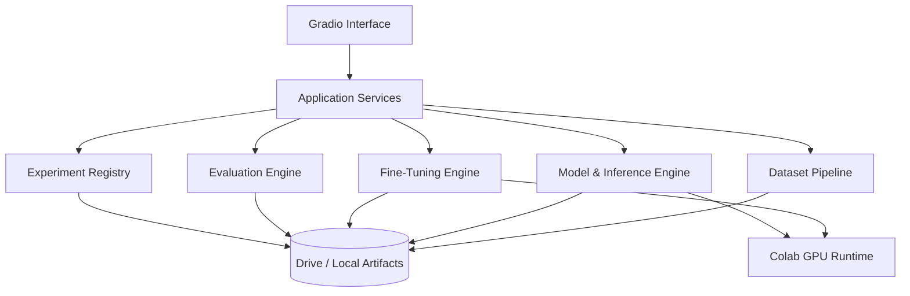

# LLM-Fine-Tuning-Studio
LLM Fine-Tuning Studio
> **An end-to-end, reproducible LLM engineering laboratory built with Python, Hugging Face, Google Colab Pro, Google Drive, and Gradio.**

   

**Project status:** Architecture and implementation roadmap defined. Features below are planned unless marked implemented. This README will be updated as milestones are delivered.

## Overview

LLM Fine-Tuning Studio is a portfolio-oriented research and engineering platform for running, adapting, evaluating, and comparing small open-weight language models. It brings model inference, dataset engineering, parameter-efficient fine-tuning, preference alignment, experiment tracking, and an interactive frontend into a single modular repository.

The project is designed to work with **Google Colab Pro for GPU execution** and **Google Drive for persistent experiment artifacts**, while remaining useful for CPU-only smoke tests and local development.

### Project goals

- Load and chat with a small open-weight LLM.
- Build reproducible SFT and preference datasets with leakage-aware splitting.
- Train and compare LoRA, QLoRA, SFT, DPO, ORPO, prompt/prefix tuning, and feasible full fine-tuning.
- Track training configurations, metrics, seeds, dependencies, checkpoints, and adapters.
- Evaluate quality, task performance, latency, throughput, and peak GPU memory.
- Manage experiments and compare base and adapted models through a Gradio dashboard.
- Export adapters, model cards, and evidence-based reports.
- Demonstrate engineering quality with automated tests, GitLab CI, documentation, and repeatable workflows.

## Architecture

The first release runs the UI and training engine within one Colab runtime. A standalone service and durable worker architecture is a possible future extension, **not a capability claimed by the initial release**.

## Technology stack

| Area | Technology |
| --- | --- |
| Language | Python 3.11+ |
| Models | Qwen3-0.6B, Qwen3-1.7B; additional compatible small models |
| Core ML | PyTorch, Transformers, Datasets, Accelerate |
| Fine-tuning | PEFT, TRL, bitsandbytes; optional Unsloth |
| Interface | Gradio |
| Experiment tracking | MLflow, TensorBoard |
| Evaluation | Custom task metrics, optional lm-evaluation-harness |
| Compute | Google Colab Pro (GPU availability varies) |
| Persistence | Google Drive and local runtime storage |
| Quality | pytest, Ruff, GitLab CI |

**Compatibility note:** Library versions, supported GPU kernels, quantization modes, and model architectures must be verified together and pinned in reproducible environments. Colab Pro does not guarantee a particular accelerator or continuous uptime.

## Planned feature matrix

| Feature | Phase | Status |
| --- | --- | --- |
| GPU diagnostics and Drive integration | 1 | Planned |
| Base model chat inference | 1 | Planned |
| Dataset import, cleaning, validation and splitting | 2 | Planned |
| SFT and LoRA | 3 | Planned |
| QLoRA and checkpoint resume | 3 | Planned |
| DPO, ORPO and preference datasets | 4 | Planned |
| Prompt/prefix tuning and continued pretraining | 4 | Planned |
| Feasible full fine-tuning and adapter merging | 4 | Planned |
| Quality and resource benchmarking | 5 | Planned |
| MLflow tracking, registry and search | 6 | Planned |
| Integrated Gradio workbench | 7 | Planned |
| CI, documentation, releases and portfolio demo | 8 | Planned |

## Roadmap

1. **Environment and inference:** reproducible setup, GPU checks, model loader, first chat UI.
2. **Dataset engineering:** ingest, validate, clean, format, split, tokenize, and report.
3. **Core fine-tuning:** SFT, LoRA, QLoRA, callbacks, checkpoints, and resume.
4. **Advanced adaptation:** DPO, ORPO, prompt/prefix tuning, continued pretraining, and resource-feasible full tuning.
5. **Evaluation:** held-out task metrics, qualitative checks, latency, throughput, VRAM, comparison reports.
6. **Experiment tracking:** MLflow, TensorBoard, run manifests, registry, hyperparameter search.
7. **Gradio application:** dashboard, datasets, training, chat, evaluation, experiments, model export.
8. **Production-quality portfolio:** tests, CI, docs, model cards, demo, and tagged release.

Each phase has explicit acceptance criteria and must be reproducible before being marked complete.

## Author and purpose

Developed as a practical LLM engineering and MLOps portfolio project demonstrating the complete lifecycle of small-model experimentation: data preparation, training, alignment, evaluation, inference, and reproducible reporting.

---

**Guiding principle:** *Build it, measure it, reproduce it, and explain the trade-offs.*
